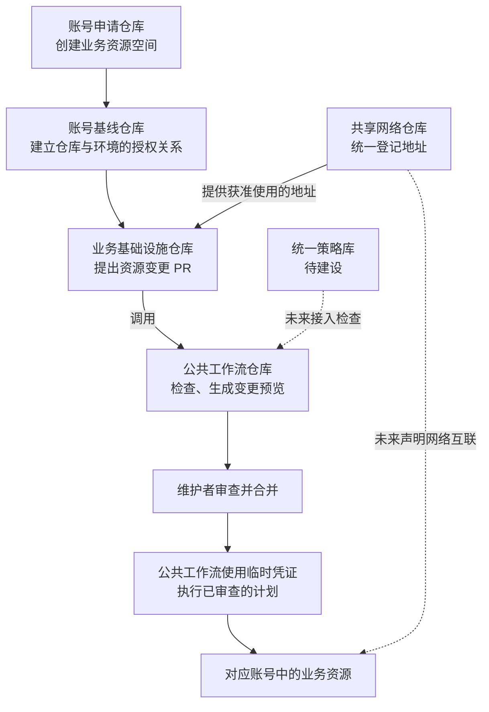

# 利林商业 · 基础设施协作入口

这份公开指南帮助你了解：**基础设施管理体系怎样运行、各个仓库怎样配合，以及要办一件事时应该去哪里提交申请。**

我们使用 GitHub 记录和审查资源变更，再通过自动化流程操作阿里云资源。这种方式叫 **GitOps**。你可以把它理解为：先提出一份“变更申请单”，确认后，再由程序按申请内容执行。

**[访问介绍网站](https://shrealin.github.io/gitops-gateway/)** · **[阅读新手指南](docs/guide/start.md)** · **[查看办理步骤](docs/guide/requests.md)** · **[了解整体架构](docs/guide/architecture.md)**

本站及其说明代码公开。关联的基础设施仓库保持私有，详细配置需要相应权限才能查看。真实地址、账号信息、组织层级、网络拓扑和运行记录均留在私有仓库。

## 我要办什么事？

| 你想做的事 | 去哪个仓库 | 在私有申请中准备什么 |
| --- | --- | --- |
| 为业务创建云账号 | [alicloud-account-vending-machine](https://github.com/shrealin/alicloud-account-vending-machine) | 业务用途、负责人、目标环境、资源归属 |
| 让仓库可以操作指定云账号 | [iac-alicloud-account-baseline](https://github.com/shrealin/iac-alicloud-account-baseline) | 仓库链接、环境名称、目标账号 |
| 申请内网地址 | [iac-shared-network](https://github.com/shrealin/iac-shared-network) | 用途、网络规模、环境、互通需求 |
| 创建或调整业务资源 | 所属业务仓库，例如 [iac-leasing-team](https://github.com/shrealin/iac-leasing-team) | 资源需求、影响范围、验证和恢复安排 |
| 让不同系统的网络互通 | [iac-shared-network](https://github.com/shrealin/iac-shared-network) | 双方系统、访问方向、业务用途；互联功能待建设 |
| 改进共用的自动化流程 | [iac-shared-tools](https://github.com/shrealin/iac-shared-tools) | 流程如何调整、影响哪些调用方、怎样验证 |
| 提出统一的资源检查规则 | [policy-library-shrealin](https://github.com/shrealin/policy-library-shrealin) | 规则目的、允许和不允许的例子；规则及接入待建设 |
| 补充这份公开指南 | [gitops-gateway](https://github.com/shrealin/gitops-gateway) | 要改的说明和可公开的依据 |

**申请通过不等于已经完成。** 日常变更需要审查、合并、自动执行成功，再确认实际结果。不会修改配置时，可以先把需求写清楚，请目标仓库维护者协助形成 PR。PR（Pull Request）就是供大家审查的变更申请。

## 整套体系怎样运行？

以“一个业务团队要上线新系统”为例：

1. **准备账号。** 在账号申请仓库创建合适的阿里云子账号，为业务提供独立的资源空间。
2. **登记部署身份。** 在基线仓库建立业务仓库、运行环境与账号的授权关系。运行时通过身份核验获取临时凭证，无需在仓库保存长期云密钥。
3. **申请网络地址。** 在共享网络仓库登记需求。先完成测试申请和验证，再单独申请生产。
4. **提出资源变更。** 在业务自己的仓库描述要创建或修改的资源，提交 PR。
5. **预览、审查、执行。** 公共工作流展示预计变化，维护者审查并合并后，再执行已确认的计划并验证结果。



图中表示职责和交接关系。**前一个申请完成，不会自动代办所有后续步骤。** 每一步都需要确认相应配置与执行结果。具体工作流版本、权限和运行情况，请登录对应私有仓库查看。

## 为什么这样设计？

| 设计 | 解决的问题 |
| --- | --- |
| 业务和环境使用对应账号 | 让资源归属清楚，降低不同业务互相影响的机会 |
| 账号创建与仓库授权分开 | “有一个账号”和“允许谁操作它”需要分别确认 |
| 使用临时凭证 | 减少长期密钥的保存和传递，让授权对应到仓库和环境 |
| 公共工作流集中维护 | 多个团队使用一致的检查与执行方式，流程改进有统一入口 |
| 网络地址集中登记 | 避免地址冲突，为未来的系统互联减少障碍 |
| 业务资源放在业务仓库 | 需求、变更和维护者更容易找到 |
| 未来集中维护检查规则 | 将共同要求变成可自动核对的规则 |
| 用 PR 记录申请和审查 | 可以回查改了什么、为什么改、由谁审查，以及执行结果 |

完整解释见[各环节如何配合](docs/guide/architecture.md)。

## 网络申请遵循什么原则？

内网地址像门牌号，需要统一登记，避免重复。各团队先向共享网络仓库提交申请，说明用途和规模，由维护者确认方案。

**测试申请 → 合并执行 → 验证 → 单独申请生产 → 确认登记 → 业务使用。** 规划中的地址、已批准的申请和已生效的分配是不同状态，不能混为一谈。

地址登记也不会自动打通两个网络。跨系统访问需要另行说明双方需求，未来由共享网络仓库中的 CEN 配置统一管理。具体地址和拓扑仅在私有仓库中查看。

详见[网络地址怎么申请](docs/guide/network.md)。

## 公开内容的边界

本站介绍通用机制、仓库职责、申请方式和词语解释。内部的账号标识、地址范围、组织树、权限明细、部署位置、运行日志及业务数据不应提交到本仓库。

公开本站不会授予关联仓库的访问权限。链接显示 404 时，先确认已登录正确的 GitHub 账号，并向内部维护者申请必要权限；不要把私有配置复制到公开讨论中。

## 维护和发布这个网站

网站使用 VitePress + Vue 构建。使用 Node.js 22 或更新版本，在本仓库根目录运行：

```sh
npm ci
npm run docs:dev
```

构建和预览正式版本：

```sh
npm run docs:build
npm run docs:preview
```

访问终端输出的本地地址，带上 `/gitops-gateway/` 路径。站点支持手机浏览、办事事项切换和中文搜索。

GitHub Pages 使用 GitHub Actions 发布：PR 会构建检查，合并到 `main` 后会自动发布。首次配置在 **Settings → Pages → Source** 中选择 **GitHub Actions**。

更新前检查 README、页面文字、首页组件、搜索索引和构建产物，确保没有复制内部细节。完整说明见[内容更新与网站发布](docs/guide/maintenance.md)。
